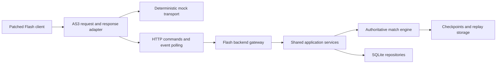

# Replacement backend and character assets plan

Prepared 2026-10-13. This is a proposed implementation plan, not an implemented backend.

## Objective and boundaries

Make the original patched Flash client usable with a self-hosted backend:
persistent accounts and teams, complete matches against CPU and human opponents,
reconnection, rankings, and the original menu features. Preserve the untouched
archive and readable patches. Linux and Android should share the same application
services and protocol adapter, with platform-specific transport/configuration only.

Replacing the original service means implementing its observable behavior. We do
not have its original server source, production database, user records, or proven
schema. Start a new database; do not promise recovery of historical accounts.
Reconstructed rules must be labeled separately from rules verified in the client.

## Findings from the current workspace

- `patches/ChannelPipeline.as` redirects outgoing requests into
  `StartUpApplicationCommand.offlineRequest`, disables real connections, and always
  reports connected. This is a useful mock seam but unsuitable connection behavior
  for a real backend.
- `patches/StartUpApplicationCommand.as` seeds local teams, handles a small set of
  menu requests, and rejects match creation with an informational popup. Editor
  changes currently live in the client session rather than persistent storage.
- `../boufbowl_server` already provides a Bun/TypeScript backend for the sibling
  Godot client: authoritative simulation, phase transitions, CPU opponents,
  account/session persistence with SQLite, teams, progression, rankings, statistics,
  social features, match checkpoints, and deterministic replay tooling.
- That server uses WebSocket messages. Compatibility with Flash message objects,
  animation events, IDs, coordinates, and rule semantics has not been established.
  Reuse is a candidate, not evidence that the SWF can connect immediately.
- Android has separate startup and asset patches. Any backend-mode refactor must
  account for both copies and retain the working offline tutorial.

## Proposed architecture

Use explicit `offline`, `mock`, and `server` modes. Preserve today's offline mode.
Mocks and the real gateway must expose the same versioned command/event contract.
The client adapter constructs the response/model types expected by the original
controllers; the mock must not silently mutate unrelated UI models.

For the first transport spike, use asynchronous HTTP JSON commands and polling or
long polling through Flash's HTTP loader. Do not assume browser-style native
WebSocket support in Flash. Confirm JSON support, response decoding, cancellation,
and sandbox behavior in both players. Serve assets and the API from the same origin
on Linux when possible; configure any necessary Flash cross-domain policy narrowly.
Android needs configurable remote server URLs rather than localhost for a PC server.

Keep transport separate so an original TCP/binary compatibility layer can be added
if unmodified-client support becomes a requirement. That requires recovering packet
framing, codecs, message IDs and socket-policy behavior, and is a larger first step.

## Implementation sequence and acceptance gates

### 1. Recover the client contract

Decompile the untouched client into a reference-only directory. Inventory request
and response classes, serializers, dispatchers, injected network modules, match
controllers, and resolution animation consumers. Trace startup, team selection,
customization, matchmaking, placement, order submission, resolution, and match end.

Produce a contract matrix with message name/ID, fields and types, requester,
response handler, error behavior, and coverage status. Record 64-bit ID handling
without losing precision in JavaScript; map identities explicitly. Document cell
coordinates, team sizes, element slots, enum values, event ordering, and units.
Inspect special-character skin-ID computation rather than assuming editor IDs are
the filenames used at runtime.

Gate: every reachable menu request is catalogued, and the complete match lifecycle
has a proposed event sequence with unknowns identified. Unknown requests become
visible, structured errors, not successful no-ops.

### 2. Build a complete deterministic mock

Extract request routing from startup into a dedicated adapter. Provide fixtures
for login/profile, multiple teams, roster/appearance edits, rankings, tournaments,
matchmaking and match setup. Include success, rejection, timeout, disconnect and
reconnect cases. Simulate the same asynchronous delivery as the eventual server.

The first match fixture should drive the original UI through placement, one legal
turn, a ball interaction, a score, and match end. Feed inbound responses through
the original handlers wherever possible. Keep tutorial playback independent.

Gate: all menu flows render and one scripted match completes on Linux and Android
with no external server. The same fixtures can later exercise the real gateway.

### 3. Prove reuse with one real vertical slice

Audit the sibling engine's rules against the Flash client. Build explicit converters
for IDs, axial/cubic coordinates, order types, teams and animation events. Trace
each engine result to the Flash resolution objects that consume it; a final state
snapshot alone is insufficient for correct original animations.

Expose transport-independent services from the sibling backend rather than routing
the Flash gateway through a fabricated Godot socket. Avoid duplicating simulation
or database logic. Build a local gateway for guest session, team load, CPU match,
placement, one resolved turn, and saved match state.

Gate: the original SWF displays a real engine turn, including movement/ball/duel
events and its authoritative final state. If event semantics or rules cannot be
mapped reliably, decide whether to extend the engine or implement a separate
legacy-compatible engine behind the same services before broadening scope.

### 4. Add persistent accounts and teams

Start with SQLite and versioned migrations for a local/small self-hosted deployment.
Reuse applicable existing tables; inspect their actual schema before adding tables.
Use isolated development/test databases and seed commands. Support guest profiles
first, then registration/login, logout, session expiry and account-owned teams.

Required logical data:

| Domain | Persistent data |
| --- | --- |
| Identity | Accounts, password hashes, hashed session tokens, profile settings |
| Teams | Clubs, roster membership, stable player IDs, attributes and appearance |
| Content | Available classes/heroes, palettes, emblems, unlocks and asset metadata |
| Matches | Participants, rules version, orders, checkpoints, results, replay references |
| Progression | XP/currency ledger, awards and rankings |
| Competition | Tournament definitions, entries, brackets and results |
| Social | Friends, blocks, messages and moderation records where supported |

Account-owned edits and rewards require transactions and server-side validation.
Use request IDs for retry-safe mutations and award each completed match only once.
Keep content identifiers separate from ownership/unlock state. Local sandbox
unlocks can remain enabled through an explicit server policy. Do not implement
real-money payments as part of restoring premium customization menus.

Gate: customization survives both client and server restarts; account A cannot
edit account B's team; retrying a request cannot duplicate edits or rewards.
Include migration, backup and restore checks. Consider PostgreSQL only when actual
concurrency or multi-instance hosting needs justify migration.

### 5. Complete authoritative matches

Add queue/challenge creation, legal placement, simultaneous order collection,
deadlines, deterministic resolution, scores, halftime, victory/draw/forfeit and
CPU opponents. The server owns accepted orders and outcomes; the client presents
them. Preserve a versioned rules snapshot, seed and ordered turn record for replay.

Reconnect uses an authenticated participant identity, event sequence/cursor and
authoritative snapshot. Handle duplicate/out-of-order commands, stale phases,
disconnect during resolution, and restart during a planning deadline.

Gate: two actual SWF clients complete a match; CPU matches complete; disconnect and
server restart recover without desynchronization; replay reproduces the outcome;
rewards are accounted exactly once. Run the Android client against the same service.

### 6. Fill remaining original menus and package deployment

Finish rankings, tournaments, player/team progression, customization entitlements,
social flows and any additional features found in the contract audit. Mark each
reachable feature implemented, deliberately adapted, or unsupported with a clear
message. Keep an explicit compatibility list instead of claiming unknown original
behavior is fully reproduced.

Provide a Linux launcher for game plus local backend, a standalone backend command,
remote Android connection settings, migration/seed commands, backup/restore
instructions and version compatibility checks. A desktop-local server does not
make Android fully offline; an embedded Android backend would be a separate scope.

Gate: fresh installation, full match, persistent edits, backup/restore and upgrade
all work with documented commands and no dependency on the old service.

## Missing character assets

The supplied regular gameplay skin inventory has these 19 missing files:

| Class | Missing variant(s) | Expected SWL file(s) |
| --- | --- | --- |
| Iop | Female | `62.swl` |
| Xelor | Male, female | `131.swl`, `132.swl` |
| Sadida | Male, female | `111.swl`, `112.swl` |
| Sacrier | Male, female | `101.swl`, `102.swl` |
| Osamodas | Male, female | `71.swl`, `72.swl` |
| Pandawa | Male, female | `81.swl`, `82.swl` |
| Eniripsa | Male | `31.swl` |
| Sram | Male, female | `121.swl`, `122.swl` |
| Feca | Male, female | `51.swl`, `52.swl` |
| Ecaflip | Male, female | `21.swl`, `22.swl` |
| Enutrof | Male | `41.swl` |

All 18 specials in `resources/offline_characters.json` have original illustrations
but lack their separate animated skins. Portrait availability does not establish
gameplay animation availability. The editor's existing illustration fallback does
not solve rendering during a match. Derive exact hero runtime paths during phase 1.

### Recovery and replacement options, in priority order

1. **Search supplied archives and local caches.** Inspect all archive revisions,
   embedded SWFs, resource bundles, old browser/Flash caches and saved downloads.
   Compare hashes and export tables, not filenames alone. Highest fidelity if found.
2. **Search historical CDN captures.** Use the source-derived targets in
   `../migration-work/archive-recovery/missing-asset-urls.json`. Obtain a Wayback
   prefix inventory once, compare against missing paths, then fetch actual matched
   captures. Include host aliases, historical port-80 URLs and revisions. Respect
   rate limits. The saved investigation hit HTTP 503; this is not proof the files
   were never archived.
3. **Inspect preservation collections.** Search Boufbowl/Gobbowl title variants in
   Flashpoint and Internet Archive uploads; inspect any associated game-data files
   and captured asset URLs. Flashpoint is a candidate source, not a confirmed copy:
   https://flashpointarchive.org/search?advanced=true.
4. **Request existing copies.** Prepare a precise missing-file manifest for Ankama,
   former contributors and preservation communities. Include expected paths, client
   version and checksums of available libraries. This plan does not send messages.
5. **Adapt compatible existing rigs.** Inspect current SWL exports and shared bone
   animations. Try one missing regular skin by building new colorizable parts on a
   compatible rig. Compare related Ankama assets only as potential source material;
   do not assume their skeletons, labels, scale or rendering contract match Boufbowl.
6. **Recreate skins deliberately.** Use surviving portraits and footage as visual
   references. Author vector parts and bind them to the verified rig/export contract.
   If a bitmap animation route is preferable, it needs a new renderer/adapter; a PNG
   sprite sheet cannot simply be renamed to `.swl`. Preserve directions, attachment
   points, depth ordering, recoloring and animation completion events.
7. **Ship an explicit temporary fallback.** Use a compatible existing animated skin
   for gameplay while keeping the character's correct portrait and identity. Resolve
   aliases through an asset registry and label substitutes. Static illustrations
   can remain editor fallbacks; they should not silently replace gameplay animation.

Start with one regular missing skin to validate the pipeline, then Goultard as the
first hero. Define animation coverage from the actual `AnimationKey` consumers and
available bone libraries rather than inventing a fixed animation/direction count.

## Asset acceptance and provenance

Maintain a manifest per asset: runtime identity/path, status (original/recovered/
recreated/substitute), origin, hash, wrapper/export information, compatible rig,
palette support and animation coverage. Keep recovered originals immutable and
replacement artwork in a separate source tree with a reproducible packaging step.

Validate wrapper decoding, SWF integrity, exported symbols, required action labels,
direction coverage, pivot/scale, team and skin colors, completion events and missing
resource behavior. Test a selected character in the editor and a complete match,
including movement, ball handling, impacts and recovery, on Linux and Android.
Replacement skins must load through Android's AIR code-import path as well.

## First work package

1. Preserve/hash the original client and create the reference decompile.
2. Write the request/response and match-event contract matrices.
3. Separate mock routing from startup and add one scripted complete match.
4. Prove a single real match turn through the existing server and Flash gateway.
5. Add persistence once that integration gate passes.
6. In parallel as an independent workstream, inventory/recover assets and validate
   one missing-skin replacement; multiplayer does not need to wait for every skin.

The main uncertainty is mapping authoritative simulation events into the original
Flash resolution pipeline. Resolve that early. Do not estimate full completion
from the existing backend's feature count alone.

## Implemented outcome

The replacement service and SQLite persistence are now in `backend/`. Linux
packages bundle the worker and Bun; Android connects to that service. Missing
animated character skins use Cra as requested, including special-character editor
previews and original 3D playback. See [operation](backend-operation.md),
[request policies](request-coverage.md), and [verification](investigation-log.md).
The earlier alternatives and staged plan above are historical design notes.
