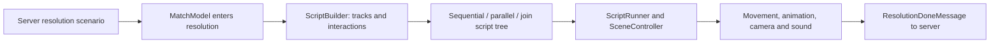

# Original Flash turn playback

Verified against the reference decompile under `../migration-work/scripts/scripts`.
This describes the original client, not the sibling Godot replay implementation.

1. `StartResolutionCommand` receives a protobuf `ResolutionScenarioMessage` and
   calls `MatchModel.switchToResolution`. The model stores the message, updates
   displayed orders, changes phase, and adds the turn to the combat log.
2. The scenario supplies player tracks, interaction entries, turn number, end tick,
   optional period information, and class-order information. It contains outcomes
   and trajectories for the client to present, rather than just input orders.
3. `ComputeResolutionCommand` updates mask information, synchronizes the scene
   model, and invokes `ScriptBuilder.build`. If 3D is disabled, it dispatches
   `SCRIPT_ENDED` immediately and skips the script.
4. `ScriptBuilder` builds player trajectories, a ball trajectory, and interaction
   functions. It wraps setup, resolution, and ending sequences in a script tree,
   then simplifies it. Its tick-to-time conversion is `MS_PER_TICK = 50`.
5. `InteractionComputer` translates recorded interaction details into presentation
   functions such as pickup, pass, reception, interception, brawl, tackle, dodge,
   fall, rebound and touchdown. Those functions build movement/animation/camera/
   sound actions. Outcome-dependent presentation uses the supplied result.
6. Sequential nodes order actions; parallel nodes allow simultaneous playback;
   join/fork nodes synchronize participants at shared interactions. This matters
   when two moving characters must meet before a fight animation can begin.
7. `ResolutionMediator` instantiates `ScriptRunner` and registers it with the scene
   controller. The runner starts scheduled nodes when playback time reaches them,
   tracks running nodes and their completion callbacks, and ends when no pending
   or running actions remain. Normal match resolution injects
   `SlowableTimeProvider(new AsvmTimeProvider())`: its base clock is Flash
   `getTimer()`, with pause/speed adjustment. Scene updates run with the display.
   A frame-based provider also exists, but is not the injected normal-match clock.
8. The mediator cleans up and dispatches `SCRIPT_ENDED`. `ScriptEndedCommand`
   sends `ResolutionDoneMessage` with the turn number and marks resolution done.
   The backend must honor the next-phase protocol and handle acknowledgement
   timeouts; animation completion is not authority for match outcomes.

There is also an original developer replay console. `ProcessCommand` parses
newline-separated hexadecimal messages into byte arrays, decodes `BoufbowlMessage`,
and injects them into either the lobby or match upstream pipeline. That is useful
for a mock/recording harness; it is not evidence of a complete end-user replay
browser with seeking and persistent recordings.

For the replacement gateway, mapping a final world snapshot alone is insufficient.
It needs to emit valid tracks, timings, interaction IDs, participants, results,
class-order information and phase messages. Preserve the client's display pipeline
and translate engine results into that contract. Do not assume the replacement
engine's tick duration is the same as this client's 50 ms playback unit.

## Completed replacement path

`backend/turn_adapter.py` now maps engine movement, pickup, combat/KO, pass,
reception/interception, rebound, goals and class abilities into the original
scenario. Real CPU matches and recorded multi-turn replays finish in the original
3D player. Shared participants link interaction tracks; pass IDs link their final
catch/rebound. Health/status updates are authoritative in the subsequent field
state. Original setup scripts handle recovery animations from the prior status.
Presentation scores are approximate displays; original server probability draws
were not available. Deterministic engine rolls and full events remain in records.
Combat ties retain damage to both participants; the original wire fight has a
first/second winner role, so the presentation uses the first fighter for that case.

## Cinematic restoration

New matches optionally enter backend `introduction` before placement. MATCH_INFORMATION
has `skipIntro=false` for an unacknowledged player. The original PlayIntroductionCommand
runs its camera/versus sequence and sends INTRODUCTION_DONE; only when all human
participants acknowledge does the server broadcast the first FIELD_STATE and start
placement's deadline. Reconnects retain intro acknowledgements. Spectators skip
intros and cannot advance them. The intro timeout starts placement independently
of a missing acknowledgement.

New turn records snapshot `presentation`. The adapter sets isCutscene for goal,
ball-carrier combat, pass, reception/interception and rebound interactions when
enabled, at most once per action type per turn.
Original interaction functions already request illustration cinematics and movies;
they do not need the absent animated-cutscene library. UIController and movie
playback catch unavailable symbols and complete callbacks so the scene can resume.
Stored scenario payloads remain unchanged; replay export and the client filter
old flags with the same current ball-only policy. Legacy records without
presentation keep the old noncinematic adapter behavior.

Experimental class powers resolve before movement. Their events record affected
player IDs, actual signed HP deltas, characteristic/range/attack modifiers,
remaining uses, Ecaflip's seeded draw, or the chosen Zobal mask. The adapter maps
HP deltas to `ClassOrderTarget.preResolutionHitPointsDelta` and masks to both
order and `ClassOrderInformation.zobalMask`, so the original class effects and
mask-change scripts play. Fight score displays include the temporary stats and
attack modifiers. Temporary bonuses expire before final state hashing; masks and
usage counters survive. Old provisional-power records still reproduce using
their stored rules and original simulation version.

ClassOrderTarget tag 4 (`effectDeltas`, repeated SINT32) carries presentation-only
power amounts. Optional HP delta fields retain their original gameplay meaning.
The original buff-number renderer now uses nonzero effect values and skips +0;
multiple distinct effects are staged to avoid overlapping numbers. The top toolbar
is hidden throughout match/replay/spectator play and returns outside the match.
Replay controls include their own Exit replay action.
